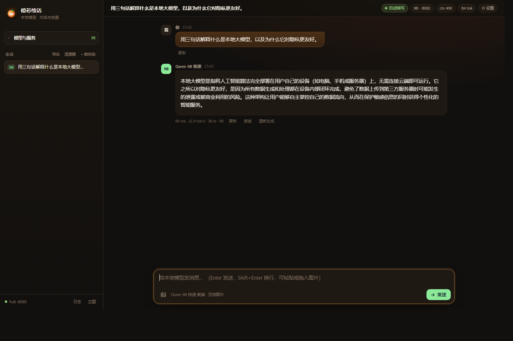

# 橙芯绘话（5070-AI）

本地运行的对话 + 绘图 + 语音工作台。一个窗口里同时管着四个模型服务，按需启动，界面统一。

因为只有一张 12GB 显卡，**四个 GPU 服务（9B、35B、SD、TTS）同一时刻只能跑一个**。软件会替你把这件事管好：启动新的之前先问你要不要卸载旧的，绝不会偷偷换模型把显存撑爆。

翻译服务是例外：它跑在 CPU 上，只占约 300MB 内存，可以和其他任何服务同时工作。

> 仓库名 **5070-AI** 来自开发时用的那张 RTX 5070——项目要解决的核心问题就是「一张卡怎么安排这么多模型」。界面里显示的名字是**橙芯绘话**。



---

## 这是什么

一个 **外壳**，不是模型本身。它把你已经装好的三套本地服务接到同一个界面里：

| 接的东西 | 干什么 |
|---|---|
| llama.cpp 的 `llama-server` | 本地大模型对话（可接任意 GGUF） |
| Stable Diffusion WebUI | 文生图 |
| IndexTTS2 | 语音合成 / 声音克隆 |

模型本身不在这个仓库里，你需要自己准备。仓库提供的是调度层、界面和那些踩过坑的适配代码。

**核心设计**：单卡环境下，多个 GPU 服务必须互斥。这个项目把"谁在跑、要不要换、显存够不够"这些判断都收进一个进程里管，避免你自己对着 `nvidia-smi` 猜。

---

## 目录

- [安装](#安装)（让 AI 代劳的话，用 [INSTALL-AI.md](INSTALL-AI.md)）
- [配置](#配置)
- [获取模型](#获取模型)
- [快速开始](#快速开始)
- [四个服务](#四个服务)
- [界面导览](#界面导览)
- [三种工作模式](#三种工作模式)
- [显存互斥规则](#显存互斥规则)
- [进度显示](#进度显示)
- [文件与数据](#文件与数据)
- [命令行参数](#命令行参数)
- [HTTP 接口](#http-接口)
- [常见问题](#常见问题)
- [实现上踩过的坑](#实现上踩过的坑)
- [许可](#许可)

---

## 安装

> **让 AI 帮你装？** 把 [`INSTALL-AI.md`](INSTALL-AI.md) 一起丢给它。那份文档把这里默认「读者能自己补全」的东西全写死了：`.bat` 的完整内容、每一步的确切命令、每个故障的确切含义。

**环境要求**

- Windows（用了 Win32 API 摆窗口，不跨平台）
- Python 3.10+（主程序只用标准库，无需 pip install）
- 一张能放下目标模型的 N 卡
- Microsoft Edge（用它的 `--app` 模式当窗口外壳）

**步骤**

```bash
git clone https://github.com/hengdaozhanjiang/5070-AI.git
cd 5070-AI
```

复制配置模板，然后按你自己的路径改：

```bash
copy config.example.json config.json
```

`config.json` 里必须改的几项：

```jsonc
{
  "llama_dir": "C:\\models\\llama",        // .bat 和 .gguf 所在目录
  "models": [
    { "bat": "start-llama-server-9b.bat",  // 相对 llama_dir
      "model": "your-model-9b.gguf",       // 相对 llama_dir
      "port": 8082 }
  ],
  "sd":  { "dir": "C:\\AI\\sd-webui" },    // 留空则禁用绘图
  "tts": { "dir": "C:\\AI\\index-tts" }    // 留空则禁用语音
}
```

然后启动：

```bash
python hub.py
```

浏览器窗口会自动打开。**只想用对话功能的话，只配 `llama_dir` 和 `models` 就够了**，SD 和 TTS 留空即可。

**可选组件**

| 组件 | 不装的后果 |
|---|---|
| Stable Diffusion WebUI | 没有绘图功能，侧栏不显示 SD 卡片 |
| IndexTTS2 | 没有语音功能，侧栏不显示语音卡片 |
| opus-mt-zh-en | 中文提示词不自动翻译，需要直接写英文 |

**关于依赖**：`hub.py` / `download.py` / `config.py` / `get-models.py` 是纯标准库，克隆下来就能跑。唯一有第三方依赖的是 `translator.py`（中文提示词翻译），它需要 `transformers`、`torch`、`sentencepiece`。默认会复用 SD 整合包自带的 Python 环境，那里通常已经有了；如果你没装 SD 又想用翻译，得自己准备一个带这些包的解释器，或者干脆不用翻译（直接用英文写提示词）。

翻译模型可以留空 `translator.model_dir`，首次运行时自动从 Hugging Face 下载（约 300MB）。

---

## 配置

所有机器相关的设置都在 `config.json`，运行时的绝对路径全部由它推导出来。

`config.py` 里那份 `DEFAULTS` 是**兜底默认值**（路径留空、端口给常见值），不是你的实际配置——别去改它，改 `config.json`。

用 `config.example.json` 作模板，里面每个字段都有 `_comment` 形式的说明。

**优先级**：`config.json` > 环境变量 > 内置默认值。环境变量适合临时试跑：

```bash
set CHENGXIN_LLAMA_DIR=D:\models
set CHENGXIN_SD_DIR=C:\AI\sd-webui
python hub.py
```

可用变量：`CHENGXIN_HOST`、`CHENGXIN_PORT`、`CHENGXIN_LLAMA_DIR`、`CHENGXIN_SD_DIR`、`CHENGXIN_TTS_DIR`。

**想接别的模型？** 改 `models` 数组就行，加一项就是一个新模型：

```jsonc
{
  "id": "27b",                    // 内部标识，唯一
  "label": "Qwen 27B",            // 侧栏显示
  "short": "27B",                 // 头像和标签上的缩写
  "color": "#ffa83d",             // 标签配色
  "port": 8083,                   // 必须和 .bat 里的一致
  "bat": "start-27b.bat",
  "model": "model-27b.gguf",
  "ctx": 32768,
  "args": ["-c", "32768", "-ngl", "99"]
}
```

前端会根据 `models` 自动渲染卡片，不需要改代码。

---

## 获取模型

权重动辄几个到二十几个 GB，**不会放进仓库**。但仓库会记住每个模型从哪来，所以不用你自己去翻下载页。

**给模型配置来源**

在 `config.json` 的模型条目里二选一：

```jsonc
// 写法 A：直接给链接
{ "url": "https://example.com/model.gguf" }

// 写法 B：Hugging Face 仓库 + 文件名
{
  "hf_repo": "<组织名>/<仓库名>",
  "hf_file": "<仓库里的文件名>.gguf"
}
```

视觉投影层（mmproj / 多模态）用 `mmproj_url` 或 `mmproj_hf_file`，写法相同。

**三种下载方式**

| 方式 | 怎么做 |
|---|---|
| 界面内 | 模型卡片会显示「缺 N 个模型文件」，点「下载」，卡片上有进度条 |
| 命令行 | `python get-models.py`（全部）或 `python get-models.py 9b`（单个） |
| 手动 | 自己下好放进 `llama_dir`，文件名和配置里的对上即可 |

`python get-models.py --list` 只查看状态不下载，很适合检查还差什么。

**断点续传**

下载先写到 `文件名.part`，中断后重跑会从断点继续，不会从零开始。二十几个 GB 的文件这点很关键。

**国内网络**

Hugging Face 直连慢的话，在配置里换成镜像：

```jsonc
"download": {
  "hf_endpoint": "https://hf-mirror.com"
}
```

**注意**：不同机构发布的 GGUF 量化版本质量差异不小。同一个模型，Q4_K_M 和 Q6_K 在长文推理上的表现能差出可感知的距离。挑的时候看一下发布者的说明。

**绘图、语音、翻译从哪来**

这三样是**外部项目**，不在本仓库里，需要你自己装：

| 组件 | 来源 | 说明 |
|---|---|---|
| Stable Diffusion WebUI | [AUTOMATIC1111/stable-diffusion-webui](https://github.com/AUTOMATIC1111/stable-diffusion-webui) | 国内也可用秋葉整合包，自带 Python 和常用扩展 |
| IndexTTS2 | [index-tts/index-tts](https://github.com/index-tts/index-tts) | Windows 整合包需带 venv 和 checkpoints |
| 翻译模型 | [Helsinki-NLP/opus-mt-zh-en](https://huggingface.co/Helsinki-NLP/opus-mt-zh-en) | cc-by-4.0，312MB，纯 CPU 运行 |

**SD 的 checkpoint** 从 [CivitAI](https://civitai.com) 下载（注意该站部分内容需登录）：

| 模型 | 地址 | 大小 |
|---|---|---|
| majicMIX realistic v7 | [models/43331](https://civitai.com/models/43331) | 1.99 GB |
| Realistic Vision V2.0 | [models/4201](https://civitai.com/models/4201) | 1.99 GB |
| AbyssOrangeMix3 (AOM3A2) | [models/122537](https://civitai.com/models/122537) | 1.99 GB |

下好放进 `<SD目录>\models\Stable-diffusion\` 即可，绘图面板会自动列出。

**默认配置使用的来源**

`config.example.json` 默认指向下面两个仓库（均为 Apache-2.0、非 gated，实测可下载）：

| 模型 | 仓库 | 文件 | 大小 |
|---|---|---|---|
| 9B Q6_K | `llmfan46/Qwen3.5-9B-Ultra-Uncensored-Heretic-GGUF` | `Qwen3.5-9B-Ultra-Uncensored-Heretic-Q6_K.gguf` | 7.4 GB |
| 9B mmproj | 同上 | `Qwen3.5-9B-mmproj-BF16.gguf` | 0.9 GB |
| 35B Q4_K_M | `JunLee88999/Qwen3.5-35B-A3B-heretic-v2-GGUF` | `Qwen3.5-35B-A3B-heretic-v2-Q4_K_M.gguf` | 21 GB |
| 35B mmproj | 同上 | `Qwen3.5-35B-A3B-mmproj-BF16.gguf` | 0.9 GB |

> ⚠️ 这两个是社区制作的**去除安全限制**版本。这里提供的是下载便利，不代表质量或适用性上的背书——用在什么场景、要不要用，请你自己判断。

**换成官方版本**

想用更保守的模型，把 `config.json` 里对应的三项一起改掉即可（`model` 必须和 `hf_file` 一致，否则下载完了启动会提示「模型文件不存在」）：

```jsonc
// 9B 档：Qwen2.5-7B-Instruct（约 4.7GB）
{
  "hf_repo": "Qwen/Qwen2.5-7B-Instruct-GGUF",
  "hf_file": "qwen2.5-7b-instruct-q4_k_m.gguf",
  "model": "qwen2.5-7b-instruct-q4_k_m.gguf",
  "mmproj": "",
  "mmproj_hf_file": ""
}

// 35B 档：Qwen2.5-32B-Instruct（约 20GB）
{
  "hf_repo": "Qwen/Qwen2.5-32B-Instruct-GGUF",
  "hf_file": "qwen2.5-32b-instruct-q4_k_m.gguf",
  "model": "qwen2.5-32b-instruct-q4_k_m.gguf",
  "mmproj": "",
  "mmproj_hf_file": ""
}
```

实测下载 879MB 的 mmproj 用 74 秒（约 12 MB/s），下载后直接启动正常。

---

## 快速开始

装好之后打开界面：

1. 左侧「模型与服务」是折叠的，点开它
2. 点某个服务卡片上的「启动」
3. 等 30 秒到 3 分钟（看哪个服务），状态变成绿色圆点「就绪」
4. 在底部输入框打字，回车发送

关掉窗口会卸载所有模型并退出后台，显存随即释放。想让它常驻，用 `--keep-after-close` 启动。

---

## 四个服务

这四个服务的路径、端口和启动参数**都在 `config.json` 里改**。`hub.py` 顶部只有一份兜底默认值（`config.py` 的 `DEFAULTS`），改那里会在你更新代码时被覆盖。

### Qwen 9B 快速（默认）

- 端口 **8082**，模型任意 GGUF（配置里的 `models[0]`）
- 40K 上下文，支持图片输入
- 加载约 14 秒（Q6_K 6.9GB，热缓存）
- **实测约 73 tok/s** 生成，431 tok/s 预填（RTX 5070，见下表）
- 日常主力：短问答、改写、看图

### Qwen 35B 深度

- 端口 **8081**，模型任意 GGUF（配置里的 `models[1]`）
- 64K 上下文，MoE 结构（每 token 只激活一部分专家）
- 实测约 40 tok/s，速度接近 9B 但知识面更广
- 加载约 40 秒（Q4_K_M 19.7GB）
- 用于长文分析、代码、复杂推理

### SD 绘图

- 端口 **7860**，指向你的 Stable Diffusion WebUI 目录（AUTOMATIC1111 或秋葉整合包）
- 用整合包自带的 `python\python.exe` 直接跑 `launch.py --api --no-hashing --skip-python-version-check`
- 支持在界面里切换 checkpoint（实测切换 1.5-36 秒）
- 中文提示词会自动本地翻译成英文

### 实测速度

RTX 5070（12GB）、Q6_K / Q4_K_M 量化下，用 `/v1/chat/completions` 返回的
`timings` 字段测量（服务端自己计的数，不是前端估的）：

| 场景 | 输入 | 输出 | 生成速度 | 预填速度 |
|---|---|---|---|---|
| 短问答 | 17 tok | 44 tok | 70.6 tok/s | 156 tok/s |
| 中等中文 | 23 tok | 118 tok | 73.0 tok/s | 421 tok/s |
| 代码生成 | 27 tok | 371 tok | 74.1 tok/s | 504 tok/s |
| 长文续写 | 22 tok | 179 tok | 73.4 tok/s | 441 tok/s |
| 长输出 | 22 tok | 1500 tok | 73.4 tok/s | — |

**9B 的生成速度中位数 73.2 tok/s，范围 70.6–74.1**——波动很小，即使连续输出
1500 token 也没有明显衰减（仍 73.4 tok/s）。

几个可以拿来对照的观感：

- 你阅读中文大约 5–8 字/秒，73 tok/s 大约是**十几倍于阅读速度**
- 一段 400 字的中文回答，通常 3–5 秒写完
- 预填速度随长度增长（156 → 504 tok/s），长提示词的「首字等待」主要花在预填

> 这些数字和模型、量化等级、上下文长度都有关。换成 Q4_K_M 会更快，Q8_0 会
> 更慢；35B 的实测约 40 tok/s（MoE 结构，体积大但每 token 只激活部分专家）。

### 语音合成

- 端口 **7862**，指向你的 IndexTTS2 目录
- 声音克隆模型：需要一段参考音频决定音色
- 默认音色是你的录音 `data/voices/我的音色-15s.wav`
- 备选两个自带女声（按音高挑的：216 Hz、256 Hz）
- 首次启动 2-3 分钟（要加载 4.4GB 权重）

---

## 界面导览

```
┌─ 侧栏 ──────────┬─ 主区域 ──────────────────┐
│ 橙芯绘话        │  对话标题        状态标签  │
│ ▸ 模型与服务 TTS│                            │
│ ─────────────── │     对话 / 图片 / 音频     │
│ 会话 导出 清理图│                            │
│  TTS 会话一     │                            │
│  SD  会话二     │                            │
│                 │  ┌──────────────────────┐ │
│                 │  │ 输入框        发送 → │ │
│ hub:8090 日志主题│  └──────────────────────┘ │
└─────────────────┴────────────────────────────┘
```

**侧栏**

- **模型与服务**：折叠分组。标题右侧直接显示当前运行的服务（绿色）。点开才是四个服务卡片（2 个聊天模型 + SD + 语音）
- **会话列表**：每个会话左边有个彩色标签，标出它属于哪种模式（9B / 35B / SD / TTS）
- **导出**：把当前对话存成一个自带图片的 HTML 文件到 `exports/`
- **清理图**：删掉 30 天前且没有任何会话引用的图片文件
- **底部**：hub 状态、日志入口、深浅色切换

**顶部状态标签**

右侧一排小标签会随模式变化：

| 模式 | 标签内容 |
|---|---|
| 聊天 | `9B · :8082` / `ctx 40K` / `5.6k tok` |
| 绘图 | `SD 绘图` / 模型名 / `离线翻译` |
| 语音 | `语音合成` / `3 个音色` / `本地合成` |

---

## 三种工作模式

模式由「哪个服务在跑」自动决定，不需要手动切换。

### 聊天模式

两个 Qwen 模型都没启动、或者 9B/35B 之一在跑时就是聊天模式。

**自动分流**：默认走 9B。满足下面任一条会弹出确认框，问你要不要换成 35B：

- 输入超过 2000 字
- 含代码块或代码声明（```` ``` ````、`def`、`class`、`function`、`import`、`#include`、`public static`）
- 带图片且超过 400 字
- 含这些词之一且超过 600 字：分析、推理、证明、推导、比较、权衡、架构、重构、优化方案、详细说明、总结全文

**只会升级，不会降级**。已经用 35B 的对话不会自动退回 9B。切换必须你点确认。

**自动续写**：回复被输出上限截断时（`finish_reason == "length"`），会自动接着写下一段。默认最多续 3 段，在设置里可以调 0-10。用的是 llama.cpp 的 `continue_final_message` + `add_generation_prompt:false`，所以接续处是连贯的，不会重复开头。

### 绘图模式

SD 启动后，新对话会直接变成绘图引导页（橙色主题）：

```
        [ SD ]
      画点什么
  直接写画面描述，回车出图 · 当前模型 MajicMix v7

  ┌─雨夜街头─┐ ┌─写实人像─┐
  ┌─风景大片─┐ ┌─二次元──┐

  [打开绘图面板（改模型 / 尺寸 / 步数）]
```

在输入框直接打字回车就出图，不用写「画一张」。图会出现在对话里，和时间、seed 一起保存。

**绘图面板**可以调：提示词、反向提示词、尺寸、步数、CFG、种子、checkpoint。面板里的提示词会自动保存，下次打开还在，也有手动「保存提示词 / 清空」按钮。

**中文提示词**：输入中文会自动用本地 CPU 翻译模型转成英文（`opus-mt-zh-en`，端口 8091，不占显存，0.5-1.7 秒）。翻译失败就用原文继续，不会卡住。

### 语音模式

TTS 启动后，新对话变成语音引导页（绿色主题）：

```
        [ TTS ]
      说点什么
  输入文字，回车合成语音 · 当前音色 我的音色-15s

  ┌─读一段新闻─┐ ┌─讲个睡前故事─┐
  ┌─念一段旁白─┐ ┌─测试我的音色─┐

  [打开语音面板（换音色 / 保存预设）]
```

打字回车就合成，音频带播放器出现在对话里。

**语音面板**可以输入文字、选参考音色、保存预设。预设包括文字和音色，打字时自动存，也有手动「保存预设 / 清空」。

**任何助手回复**下面都有「朗读」按钮，点一下就把那段话读出来。

**添加自己的音色**：把一段 wav 放进 `data/voices/`，面板列表里就会出现，标着「我的」。建议 5-20 秒、安静环境、单人说话。

---

## 显存互斥规则

这是整个软件最核心的约束。实测数据（RTX 5070，12227 MiB）：

| 状态 | 显存占用 |
|---|---|
| 系统基础 | 约 0.6-0.9 GB |
| Qwen 9B | 约 8-9 GB |
| Qwen 35B | 约 11 GB |
| SD | 约 9-10 GB |
| IndexTTS | 约 10.7 GB |
| **两个同时跑** | **放不下，会卡死** |

所以规则是硬性的：

1. 启动任何服务时，如果别的在跑，**返回 `needsReplace` 而不是启动**
2. 界面弹确认框：「X 正在运行。显卡同时只能跑一个 GPU 服务，要先停掉它才能启动 Y」
3. 你点确定后才真的卸载旧的、启动新的
4. **发消息永远不会自动启动模型**。模型没跑就提示你去点启动

这套逻辑在 `hub.py` 的 `_model_action()` 里，SD 和 TTS 也纳入检查。早期版本漏掉过 TTS，导致启动 9B 时把显存撑爆卡死——已修复。

---

## 进度显示

两个耗时任务都有实时进度条。

### SD 绘图：真实百分比

SD 自带 `/sdapi/v1/progress` 接口。hub 在后台线程发起渲染，同时每 0.7 秒问一次进度，转发给界面。

实测曲线：

```
  0.4s   2%   加载模型
 81.2s   1%   加载模型        ← 换 checkpoint/加载权重，约 80 秒
 94.2s  11%   scripts_txt2img
 97.5s  38%
100.5s  81%
102.6s 100%   完成
```

加载权重那段进度不动，会显示「加载模型」而不是让人以为卡死。

### 实测速度

RTX 5070（12GB）、Q6_K / Q4_K_M 量化下，用 `/v1/chat/completions` 返回的
`timings` 字段测量（服务端自己计的数，不是前端估的）：

| 场景 | 输入 | 输出 | 生成速度 | 预填速度 |
|---|---|---|---|---|
| 短问答 | 17 tok | 44 tok | 70.6 tok/s | 156 tok/s |
| 中等中文 | 23 tok | 118 tok | 73.0 tok/s | 421 tok/s |
| 代码生成 | 27 tok | 371 tok | 74.1 tok/s | 504 tok/s |
| 长文续写 | 22 tok | 179 tok | 73.4 tok/s | 441 tok/s |
| 长输出 | 22 tok | 1500 tok | 73.4 tok/s | — |

**9B 的生成速度中位数 73.2 tok/s，范围 70.6–74.1**——波动很小，即使连续输出
1500 token 也没有明显衰减（仍 73.4 tok/s）。

几个可以拿来对照的观感：

- 你阅读中文大约 5–8 字/秒，73 tok/s 大约是**十几倍于阅读速度**
- 一段 400 字的中文回答，通常 3–5 秒写完
- 预填速度随长度增长（156 → 504 tok/s），长提示词的「首字等待」主要花在预填

> 这些数字和模型、量化等级、上下文长度都有关。换成 Q4_K_M 会更快，Q8_0 会
> 更慢；35B 的实测约 40 tok/s（MoE 结构，体积大但每 token 只激活部分专家）。

### 语音合成：估算

IndexTTS **不上报进度**（实测它的数据流只发心跳，没有 progress 事件）。所以采用估算：

- 读它的日志判断阶段：准备中 → 加载模型 → 正在合成语音
- 每个阶段按不同速率推进百分比
- 后台上报线程每 0.5 秒更新一次

实测：

```
 0.5s  10%  加载模型
 3.3s  17%  准备中
10.5s  34%  准备中
23.8s  91%  正在合成语音
25.0s 100%  完成
```

不精确，但能看出在动、大概还要多久。

进度会显示在：绘图面板按钮下方、语音面板按钮上方、聊天流里的临时消息中。

---

## 文件与数据

```
5070-AI\
├─ README.md           本文件（给人读）
├─ INSTALL-AI.md       安装指引（给 AI 读，含 .bat 模板与排错）
├─ LICENSE             MIT
├─ hub.py              主程序（后端 + 静态服务 + 反向代理）
├─ config.py           配置加载（config.json + 环境变量覆盖）
├─ config.example.json 配置模板，复制成 config.json 再改
├─ download.py         模型下载器（断点续传 + 进度）
├─ get-models.py       命令行批量下载
├─ translator.py       中英翻译服务（opus-mt-zh-en，CPU）
├─ tts_launch.py       IndexTTS 启动包装（绕开 DLL 冲突）
├─ app.ico             主图标（橙子）
├─ tts.ico             语音快捷方式图标（麦克风）
├─ ui/
│  ├─ index.html       主界面
│  ├─ app.js           全部前端逻辑
│  ├─ styles.css       橙色主题
│  ├─ draw.html        独立绘图页（保留，主界面内已集成）
│  ├─ logo.png         侧栏 logo
│  └─ vendor/          marked.js、purify.js（本地，不联网）
├─ tests/
│  └─ test_core.py     单元测试（35 个用例，纯标准库）
├─ tools/
│  ├─ gen_icon.py      生成 app.ico / logo.png
│  └─ gen_tts_icon.py  生成 tts.ico
├─ data/
│  ├─ chats.json       全部会话（图片只存文件名，不存 base64）
│  ├─ images/          对话里的图片，按 sha1 命名
│  ├─ speech/          生成的语音
│  ├─ voices/          参考音色（放你自己的 wav 进来，不进 git）
│  ├─ window.json      上次的窗口位置尺寸
│  └─ edge-profile/    Edge 应用窗口的用户数据
├─ exports/            导出的 HTML 对话
├─ outputs/            手动"保存图片"存到这里
└─ logs/               各服务日志
```

**会话存储**：`chats.json` 里图片存成 `{"dataUrl":"","file":"<sha1>.png"}`，实际文件在 `data/images/`。读取时才还原成 data URL 给浏览器。这样 json 不会膨胀到几十兆。

**单实例**：同时只能开一个窗口。再次双击快捷方式会聚焦已有窗口，不会开第二个。聊天记录按 id 合并，不会互相覆盖。

**清理图片**：只删「30 天前」且「没有任何会话引用」的文件。会话里用着的图，再老也不删。

---

## 命令行参数

```bash
python hub.py [--port 8090] [--no-browser] [--keep-after-close] [--open tts|draw]
```

| 参数 | 作用 |
|---|---|
| `--port` | 换端口，默认 8090 |
| `--no-browser` | 只起服务，不开窗口 |
| `--keep-after-close` | 关窗口不卸载模型、不退出 hub |
| `--open tts` | 启动后直接打开语音面板 |
| `--open draw` | 启动后直接打开绘图面板 |

默认行为是**关窗口即卸载所有模型并退出**，显存立刻释放。

---

## HTTP 接口

hub 在 `127.0.0.1:8090` 上提供这些接口：

| 方法 | 路径 | 作用 |
|---|---|---|
| GET | `/api/state` | 全部服务状态（模型、SD、TTS、音色列表） |
| POST | `/api/start` | 启动聊天模型 `{model, replace}` |
| POST | `/api/stop` | 停止聊天模型 `{model}` |
| POST | `/api/download` | 下载缺失的模型权重 `{model}` |
| GET | `/api/progress` | 长任务的进度（sd / tts / download） |
| POST | `/api/sd/start` `/stop` | 启动/停止 SD |
| POST | `/api/sd/select` | 切换 checkpoint `{name}` |
| POST | `/api/sd/generate` | 出图 `{prompt, negative, width, height, steps, cfg, seed}` |
| POST | `/api/sd/interrupt` | 中断当前渲染 |
| POST | `/api/sd/save` | 保存图片到 outputs |
| POST | `/api/tts/start` `/stop` | 启动/停止语音 |
| POST | `/api/tts/speak` | 合成语音 `{text, voice}` |
| GET | `/api/tts/log` `/api/sd/log` | 服务日志 |
| GET | `/api/chats` | 读会话 |
| POST | `/api/chats` | 写会话（按 id 合并） |
| POST | `/api/chats/export` | 导出 HTML `{id}` |
| POST | `/api/images/cleanup` | 清理旧图 `{days}` |
| GET | `/audio/<name>` | 播放生成的语音 |
| GET/POST | `/v1/*` | 转发给当前运行的聊天模型 |

所有接口只监听 `127.0.0.1`，并检查 `Host` 头，防止 DNS rebinding。

**翻译服务（端口 8091）不在上表里**：它是 hub 内部用来把中文提示词转成英文的，由 hub 自己拉起和调用，不对外暴露，前端也不直接访问它。

---

## 常见问题

**问：启动时说「X 正在运行」，怎么办？**

点确认就行，它会卸载那个再启动你要的。这是设计如此——两个一起跑会卡死。

**问：9B 一直显示「加载中」不出来？**

大概率是显存被别的占了。看一眼 `nvidia-smi`，或者把其他服务停掉重试。

**问：语音合成的进度条不准？**

IndexTTS 不上报进度，这是估算的。百分比只能看趋势，不是精确值。

**问：中文提示词翻译得不好？**

翻译模型是 `opus-mt-zh-en`，专门为短句优化。太抽象的文学描述可能翻得生硬，建议直接用英文写提示词。

**问：想加自己的音色？**

把 wav 放进 `data/voices/`，刷新面板就会出现。建议 5-20 秒清晰人声。太长的参考音频（比如超过 30 秒）反而容易让克隆效果变差。

**问：导出的 HTML 特别大？**

因为图片被内联成 base64 了。带很多图的对话会到十几兆，这是为了让文件能独立打开、不依赖原目录。

**问：窗口大小不对？**

关窗口时会记下来。想重置就删掉 `data/window.json`。

---

## 实现上踩过的坑

这些是实际调试时遇到的问题，记在这里免得以后重犯。

**Edge 不认 `--window-size`**
Chromium 会恢复它自己记的尺寸，命令行参数被忽略。必须在启动后用 Win32 `SetWindowPos` 强制摆，而且要连续 4 次确认位置对上了才停手（Edge 会中途再改一次）。

**最大化状态下 `SetWindowPos` 无效**
得先 `ShowWindow(SW_SHOWNORMAL)` 取消最大化，再摆位置。

**`pythonw.exe` 没有 stderr**
`log_message` 里往 `sys.stderr` 写会直接崩。加了 None 判断，日志改写到 `logs/hub.log`。

**Popen 的 stdout 管道不读会阻塞**
模型加载时输出很多，管道没人读，缓冲区满了进程就卡住。改成重定向到日志文件。

**IndexTTS 启动即崩：`kaldifst` DLL 初始化失败**
逐层测出来的：单独 `import kaldifst` 正常，先 `import torch` 再 `import kaldifst` 就失败。torch 加载的 MKL/OpenMP 覆盖了 kaldifst 需要的版本。
解法是 `tts_launch.py` 在导入 torch 之前先导入 kaldifst，然后 `runpy` 跑真正的 `webui.py`。不改动原项目文件。

**IndexTTS 端口冲突**
它默认 7860，和 SD 完全一样。改成 7862。

**Gradio 5 的 API 不是 `/api/predict`**
分三步踩：
1. 旧路径 404，实际是 `/gradio_api/call/<api_name>`
2. 音频参数不能传路径字符串，必须是带 `meta._type` 的 FileData 对象
3. 还不能直接引用本地文件——必须先 POST 到 `/gradio_api/upload` 拿服务端副本

**SD 整合包的 `webui.bat` 不能直接调**
它会创建一个空 venv 然后试图下载 2.4GB 的 torch，失败后窗口一闪就关。必须用 `python\python.exe` 直接跑 `launch.py`。

**图标缓存 & BMP 字节序**
`.ico` 全用 PNG 压缩帧时，资源管理器经常显示旧图标。标准做法是小尺寸用 BMP、只有 256 用 PNG。
而且 BMP 是 **BGRA** 顺序，写成 RGB 会让红色和蓝色对调——橙色橙子会变成蓝色，这个 bug 很隐蔽。

**`const` 定义的不是 `window` 属性**
自动化测试里 `win.state` 拿不到，只能操作 DOM。

**进度条一开始完全不出现**
时序问题：首次轮询时后端还没开始任务，状态是 `idle`，前端就放弃了。加了 8 秒宽限期。

**TTS 进度上报线程会泄漏**
流读取抛异常时跳过了 `stop_tick.set()`，线程永远活着。改成 `try/finally` 保证一定能停。

---

## 测试

```bash
python -m unittest discover -s tests -v
```

35 个用例，一两秒跑完。

**不依赖任何第三方包**，也不需要启动模型：测试 import 的 `hub` / `config` / `download` 本身就是纯标准库，所以 clone 下来直接能跑，不用先装环境。

| 组 | 测什么 |
|---|---|
| `ConfigTests` | 配置合并语义、环境变量优先级、「只改一个键不丢兄弟键」 |
| `DownloadTests` | 断点续传的前置逻辑、URL 推导、GGUF 文件头校验、大小不符检测 |
| `HubTests` | 端口不重复、`config_problems` 能抓出坏路径、显存读取、`probe` 在模型文件缺失时不崩 |
| `ChatStoreTests` | 按 id 合并、墓碑删除、图片从 data URL 抽成文件、读回时还原 |
| `CleanupTests` | 只删「够老」且「没人引用」的图；被引用的再老也留着 |

这些测试在重构 `_build_models` 那类改动后特别有用——端口或字段漏掉时立刻报错，而不是等启动时才发现。

---

## 发布到 GitHub

仓库自带了 `publish.ps1`，会自动检查敏感文件、建仓并推送。

**第一次需要登录一次**（之后凭据会被记住）：

```powershell
gh auth login
# 选 GitHub.com -> HTTPS -> Login with a web browser
```

然后：

```powershell
.\publish.ps1                    # 仓库名默认 5070-AI
.\publish.ps1 -RepoName my-tool  # 自定义名字
.\publish.ps1 -Private           # 建私有仓库
```

脚本会先复查 `git ls-files`，确认 `config.json`、录音、聊天记录、日志都没混进去，然后才推送。

**关于代理**：本机访问 GitHub 需要走系统代理（`127.0.0.1:65532`）。脚本会自动读取注册表里的代理设置并传给 `gh`。如果你的环境不需要代理，删掉脚本里那段赋值即可。

---

## 许可

[MIT](LICENSE) © 橙芯绘话 contributors

模型权重不在本仓库内，各自遵循其原始许可。使用本项目接入的任何模型，请自行确认该模型的授权条款。